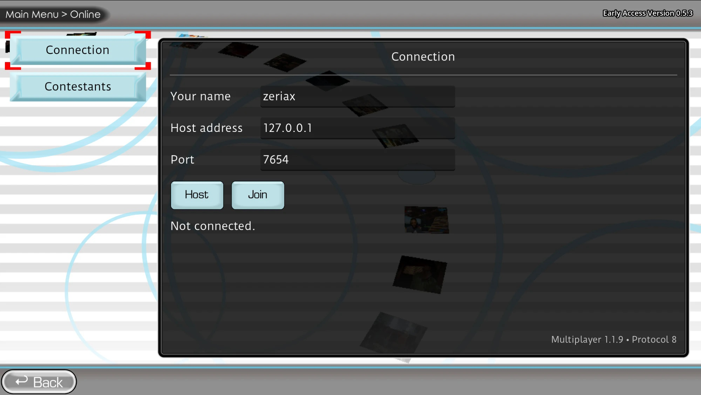

# Choicer Voicer Multiplayer

Play [The Choicer Voicer](https://yeahmaybe.itch.io/the-choicer-voicer) online with friends, download dub packs from GameBanana without leaving the game, and save every dub as a video.

This is a fork of [Appolo's multiplayer mod](https://github.com/TypeOneAppolo/tcv-multiplayer-mod). Everything fits into the game's own menus, buttons and fonts, so it feels like part of the game.

## Why I made this

The Choicer Voicer is one of the most fun games I've played in a long time, and making mods for it has turned into a new passion of mine. If you enjoy these mods, please [buy the game on itch.io](https://yeahmaybe.itch.io/the-choicer-voicer). It's pay-what-you-want, and YeahMaybe deserves every bit of support. None of this would exist without their game.

## What it adds

- **Online play.** Host or join a game over the internet or your local network, in Gameshow or Dub Mode.
- **Community packs.** Search, download and remove GameBanana dub packs from the main menu. ZIP and RAR packs both work, downloads keep going in the background, and slow download servers are skipped automatically.
- **Save as video.** When you press **Save Dub**, the button fills up while your dub is turned into an MP4 with your voice mixed in. Click **Open video** to watch it. If it fails, click **Retry video**. Works on Windows, macOS and Linux; see [Save as video](#save-as-video) for what it needs.

## Install on Windows

You need:

- **The Choicer Voicer 0.5.3**, the standard Windows download from [itch.io](https://yeahmaybe.itch.io/the-choicer-voicer).
- **Python 3** from [python.org](https://www.python.org/downloads/). In the installer, tick **Add python.exe to PATH**.

Steps:

1. Extract the game's ZIP somewhere you'll keep it.
2. [Download this mod](https://github.com/zeriaxdev/tcv-multiplayer/archive/refs/heads/main.zip) and extract the whole ZIP. Don't run anything from inside the ZIP.
3. Drag the game's `.exe` onto `Install.bat`.
4. Wait while it downloads Godot and GDRETools and builds the modded game. The first run takes a few minutes.
5. Open the new executable it creates next to the original.

Keep the original `.exe`. When the game or this mod updates, run the installer on the original again.

## Install on Mac

The game only comes out for Windows, so on a Mac you build a native app from the Windows download:

1. [Download this mod](https://github.com/zeriaxdev/tcv-multiplayer/archive/refs/heads/main.zip) and extract it.
2. Follow the [Mac Builder](https://github.com/zeriaxdev/tcv-macos) guide and add `--mod` with the path to this folder.

## Play online

1. Open **Online (F9)** from the main menu.
2. Enter your name. One player picks **Host**. Everyone else types the host's address and picks **Join**.
3. Everyone uses the same port. The default is **7654**.
4. Pick a game mode and mark yourself **Ready**.

The host's address can be:

- a local address, if you're on the same network,
- a [Tailscale](https://tailscale.com/) address, which is the easiest way to play over the internet,
- or the host's public address, with **UDP port 7654** forwarded on their router.

Allow the game through your firewall when asked. Everyone needs the same mod version: **1.1.9, protocol 8**. It's shown at the bottom of the Online menu.

In Dub Mode, the host can offer their packs to the other players before a round. Each player chooses whether to download them. The [original mod's guide](UPSTREAM_README.md) has more on game modes and pack sharing.

## Community packs

Open **Community packs** from the main menu.

- **Browse packs:** search GameBanana or sort by newest or most liked, then pick a file and press **Download**.
- **Installed packs:** everything installed through the browser. Removing a pack asks first, and packs you installed by hand are never touched.
- **Downloads:** progress for each pack in the queue, with a **Cancel** button.

Want only the pack browser, without online play? Use [Community Packs](https://github.com/zeriaxdev/tcv-community-packs) instead. Pick one of the two mods per build.

## Save as video

The installer puts `exporter.py` next to the game (inside the app on macOS). It needs two free tools:

- **Python 3:** on Windows from [python.org](https://www.python.org/downloads/) (tick **Add python.exe to PATH**). macOS and most Linux systems already have it.
- **FFmpeg:**
  - Windows: open Command Prompt and run `winget install Gyan.FFmpeg`, then restart the game.
  - macOS: `brew install ffmpeg` with [Homebrew](https://brew.sh/).
  - Linux: install `ffmpeg` with your package manager.

Videos are H.264 MP4s at the pack's own resolution, with a lossless WAV next to each one. Tested on macOS; Windows and Linux use the same code but haven't been tested yet. If the button says **No exporter**, rebuild the game with the latest installer. If it says **Needs Python**, install Python as above.

To export older dubs, or to back up your packs and dubs to iCloud Drive, Google Drive, Dropbox or a NAS, use the [Exporter](https://github.com/zeriaxdev/tcv-exporter).

## Where your files are

The game keeps packs, saved dubs and logs in its data folder:

| System | Folder |
| --- | --- |
| Windows | `%APPDATA%\YeahMaybe\ChoicerVoicer` |
| macOS (built with the [Mac Builder](https://github.com/zeriaxdev/tcv-macos), since there's no official Mac version) | `~/Library/Application Support/YeahMaybe/ChoicerVoicer` |
| Linux | `~/.local/share/YeahMaybe/ChoicerVoicer` |

Inside it:

- `game/packs_voice`: dub packs, including the ones you download in the game
- `game/recordings/dub_recordings`: your saved dubs, one folder per pack and session
- `logs`: the game log, with download and video errors

Videos from **Save Dub** go to `Choicer Voicer Exports` in your Videos folder (`Movies` on macOS).

## If something goes wrong

- **Check the game log** in the `logs` folder above. Download and video errors are written there.
- **Can't connect:** check the port, the firewall and that everyone runs version 1.1.9. Tailscale avoids most router problems.
- **Open an issue** with the log attached.

[Testing and compatibility](VALIDATION.md) lists what has been tested so far. The Windows installer of this fork hasn't had a full end-to-end test yet, and playing Mac against Windows hasn't been tested.

## How it works

The installer recovers the game's project from your own copy with GDRETools, adds this mod's scripts and a few small hooks into the game's scripts, and exports a new executable with Godot. The game's art, sound and fonts are loaded from your copy at runtime. None of them are included in this repository.

## Unofficial project

This is a fan-made project. It is not made by, endorsed by or affiliated with YeahMaybe, the creator of [The Choicer Voicer](https://yeahmaybe.itch.io/the-choicer-voicer). The game's only official sources are its itch.io page and YeahMaybe's website.

- You need your own copy of the game. Get it from the [official itch.io page](https://yeahmaybe.itch.io/the-choicer-voicer).
- This repository contains no game files. Share this project's code, never a game you built with it: a built game contains YeahMaybe's work.
- Dub packs come from [GameBanana](https://gamebanana.com) and belong to their creators.

If you are YeahMaybe and want anything changed or taken down, [open an issue](https://github.com/zeriaxdev/tcv-multiplayer/issues) and it will be handled promptly.

## Credits and license

- **TypeOneAppolo (Appolo)** made the original multiplayer mod: [TypeOneAppolo/tcv-multiplayer-mod](https://github.com/TypeOneAppolo/tcv-multiplayer-mod). This repository is a fork of it. [Support Appolo on Ko-fi](https://ko-fi.com/appolodev).
- **Herjuus** wrote the original community pack browser, download queue, installer and host pack sync.
- **zeriaxdev** added the native game menus, macOS support, fast downloads, RAR support and automatic video export.
- [The Choicer Voicer](https://yeahmaybe.itch.io/the-choicer-voicer) is made by **YeahMaybe**.
- Built with [Godot](https://godotengine.org/) and [GDRETools](https://github.com/GDRETools/gdsdecomp), which have their own licenses.

The mod code is available under the [MIT license](LICENSE); see [notices](NOTICE.md). The license does not cover the game, its files or community packs.
