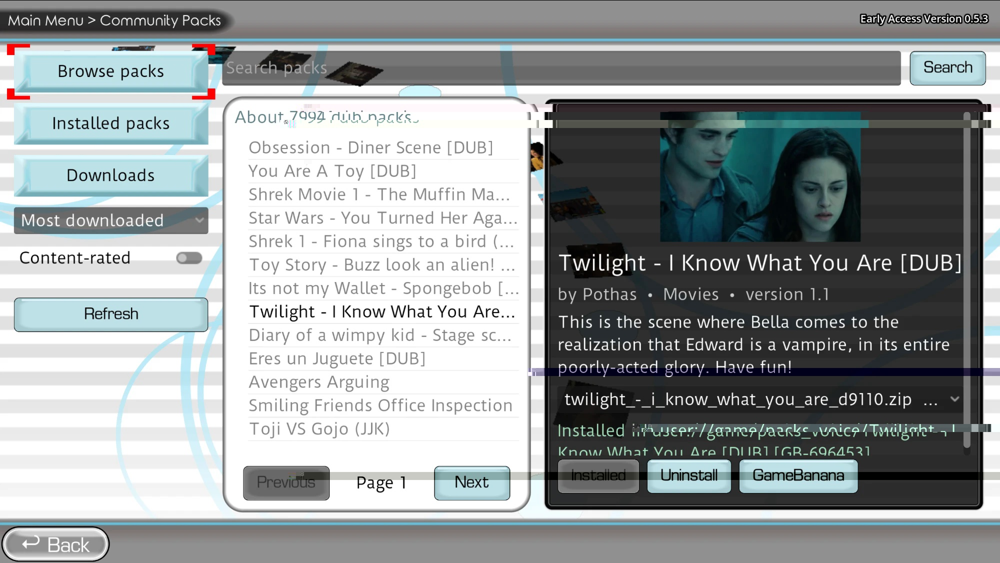

# tcv-mods

Online multiplayer, an in-game dub pack browser, video saving and caption translations for The Choicer Voicer.

Also on [GameBanana](https://gamebanana.com/mods/741068).



## Table of Contents

- [Background](#background)
- [Features](#features)
- [Install](#install)
- [Usage](#usage)
- [Where your files are](#where-your-files-are)
- [Troubleshooting](#troubleshooting)
- [Unofficial project](#unofficial-project)
- [Contributing](#contributing)
- [Thanks](#thanks)
- [License](#license)

## Background

[The Choicer Voicer](https://yeahmaybe.itch.io/the-choicer-voicer) is one of the most fun games I've played in a long time, and making mods for it has turned into a new passion of mine. You need your own copy of the game for any of this, so please buy it on itch.io. It costs $5, you can pay more if you like, and YeahMaybe deserves every bit of support. None of this would exist without their game.

This repository started as a fork of [Appolo's multiplayer mod](https://github.com/TypeOneAppolo/tcv-multiplayer-mod). It now holds all of my mods for the game in one place, and you choose which ones to install. Everything fits into the game's own menus, buttons and fonts.

## Features

| Feature | What it does | Needs |
| --- | --- | --- |
| **Community Packs** | Search, download and remove GameBanana dub packs from the main menu. ZIP, RAR and 7z packs all work, downloads keep going in the background, and slow download servers are skipped. | Always included |
| **Multiplayer** | Host or join Gameshow and Dub Mode online, and share packs with the players in your lobby. Includes the fix for silent mic recordings on Windows. | Community Packs |
| **Save as video** | **Save Dub** also turns your dub into an MP4 with your voice mixed in. The button fills up while it works, then says **Open video**. | Python 3 and FFmpeg |
| **Translations** | Translate a dub pack's captions into your own language. Dub Mode shows your translation with the pack's original caption under it. The pack itself stays as it is. | Nothing |


## Install

You need **The Choicer Voicer 0.5.3**, the standard Windows download from [itch.io](https://yeahmaybe.itch.io/the-choicer-voicer). The installer builds a modded copy from it and never changes your original.

### Windows

1. Install **Python 3** from [python.org](https://www.python.org/downloads/). Tick **Add python.exe to PATH**.
2. For **Save as video**, also install FFmpeg: open Command Prompt and run `winget install Gyan.FFmpeg`.
3. Extract the game's ZIP somewhere you'll keep it.
4. Download `tcv-mods-<version>.zip` from the [latest release](https://github.com/zeriaxdev/tcv-mods/releases/latest) and extract the whole ZIP. Don't run anything from inside the ZIP.
5. Drag the game's `.exe` onto `Install.bat`.
6. Answer which features you want. Press Enter to take each one.
7. Wait while it downloads Godot and GDRETools and builds the game. The first run takes a few minutes.
8. Open the new `TheChoicerVoicer-Mods` executable next to the original.

Keep the original `.exe`. When the game or these mods update, run the installer on the original again.

### macOS

The game only comes out for Windows, so on a Mac you build a native app from the Windows download. You need:

- Python 3.9 or newer, and for **Save as video** FFmpeg: `brew install ffmpeg` with [Homebrew](https://brew.sh/).
- [Godot 4.4.1 for macOS](https://github.com/godotengine/godot-builds/releases/tag/4.4.1-stable) and the **export templates** from the same page (`Godot_v4.4.1-stable_export_templates.tpz`).
- [GDRETools 2.6.3 for macOS](https://github.com/GDRETools/gdsdecomp/releases/tag/v2.6.3).

Then:

1. Move Godot and GDRETools to **Applications**.
2. Download `tcv-mods-<version>.zip` from the [latest release](https://github.com/zeriaxdev/tcv-mods/releases/latest) and extract it.
3. Open Terminal in that folder and run, with your own paths:

```sh
python3 mac/build.py "/path/to/the-game.zip" \
  --godot "/Applications/Godot.app" \
  --gdre "/Applications/Godot RE Tools.app" \
  --templates "/path/to/Godot_v4.4.1-stable_export_templates.tpz" \
  --output "$HOME/Applications/The Choicer Voicer.app"
```

4. Open the new app in your home **Applications** folder and allow microphone access.

All features are included by default. To pick, add for example `--features community-packs,save-as-video`. Add `--icon "/path/to/icon.icns"` for a custom icon. The app is signed on your Mac but not notarized by Apple.

## Usage

### Play online

1. Open **Online (F9)** from the main menu.
2. Enter your name. One player picks **Host a game** and presses **Open lobby**. Their addresses are hidden until they tick **Show**, and **Copy** works either way.
3. Everyone else picks **Join a game**, types the host's address and presses **Join**. The port is under **Advanced**. The default is **7654**, and everyone needs the same one.
4. On **Contestants**, mark yourself **Ready** and pick a game mode. The modes unlock once a second player joins.

The host's address can be a local address on the same network, a [Tailscale](https://tailscale.com/) address (the easiest way to play over the internet), or the host's public address with **UDP port 7654** forwarded on their router. Allow the game through your firewall when asked. Everyone needs a matching version of the mod. If they don't match, the Online menu says who needs to update. Appolo's original mod 1.1.9 also works with this one.

In Dub Mode, the host can offer their packs to the other players before a round, and each player chooses whether to download them. The [original mod's guide](UPSTREAM_README.md) has more on game modes and pack sharing.

### Community packs

Open **Community packs** from the main menu.

- **Browse packs:** search GameBanana or sort the list, pick a file and press **Download**.
- **Installed packs:** everything installed through the browser. Removing a pack asks first, and packs you installed by hand are never touched.
- **Downloads:** progress for each pack, with a **Cancel** button.

### Save as video

Press **Save Dub** after a dub. The video goes to `Choicer Voicer Exports` in your Videos folder (`Movies` on macOS): an H.264 MP4 at the pack's own resolution, with a lossless WAV next to it. If it fails, the button says **Retry video**. **No exporter** means the game was built without this feature, and **Needs Python** means Python is missing.

### Translations

Pick a pack in Dub Mode and press **Translation** next to **Start**.

1. **Export script** saves the pack's captions as a text file, one line per clip:
   ```
   1 | 01_intro.wav | Clark | Hello there.\nHow are you?
   ```
2. Translate the caption at the end of each line, by hand or by pasting the whole file into a translator and copying the result back. Leave the number, file name and character alone. `\n` starts a new line inside a caption.
3. **Import translation** loads the file and Dub Mode starts using it. Lines you skipped keep the original caption.

A pack can have more than one translation, like a second language or a friend's version. Each import is named after its file, so `Backrooms suomi.txt` becomes **suomi**. Importing a file with the same name again replaces that translation. Pick the one Dub Mode shows in the same window, or pick **Original captions** to turn translations off. The button on the pack page shows your pick, for example **Translation: suomi**.

Translations are saved on your computer in `translations/<pack folder>` (see [Where your files are](#where-your-files-are)), never in the pack, so online games still see the same pack. To dub together in your language, send your friends the translated file and have each of them import it.

### Export older dubs, or back them up

The `exporter` folder works on its own, on every system:

```sh
python3 exporter/exporter.py --library
python3 exporter/exporter.py --export --pack "pack folder" --session "saved session" --output "my dub.mp4"
```

On Windows, use `py` instead of `python3`. On macOS you can also build an app window for it:

```sh
python3 exporter/build_app.py --output "$HOME/Applications/Choicer Voicer Exporter.app"
```

### Back up your packs and dubs

The exporter copies your packs, saved dubs and exported videos into a folder of your choice. To get them into the cloud, pick a folder that a sync app already uploads: iCloud Drive, Google Drive for desktop, Dropbox, OneDrive or Synology Drive. A NAS or WebDAV share works too once it's connected in Finder (**Go → Connect to Server**) or File Explorer (**Map network drive**). The exporter never signs in to anything itself; the sync app or the network share does the uploading.

In the macOS app:

1. Under **Cloud backup**, click **Choose folder…** and pick a folder inside your synced folder, for example `iCloud Drive/Choicer Voicer Backup`.
2. Choose what to include: packs, recordings (your saved dubs) and videos (only videos made by the exporter).
3. Click **Preview backup** to see how many files would be copied, then **Back up now**.
4. Optional: turn on **Back up automatically after playing**. It checks every two minutes, waits while the game is running, and keeps working after a restart. Keep the app where it is, or the automatic backup stops working; turn the option off to remove it.

On any system, the same backup runs from the command line:

```sh
python3 exporter/exporter.py --backup "/path/to/synced/folder" --categories packs,recordings,videos \
  --exports-folder "$HOME/Movies/Choicer Voicer Exports"
```

Backups only ever add files. Nothing is deleted, unchanged files are skipped, and if a file in the backup differs from yours, both are kept, the backup one renamed with `(conflict-…)`. It's one-way: to restore, copy the folders back into the game's data folder (see below). The backup has `packs_voice` and the other `packs_` folders, `recordings` and `exports`.

## Where your files are

| System | Folder |
| --- | --- |
| Windows | `%APPDATA%\YeahMaybe\ChoicerVoicer` |
| macOS (built with `mac/build.py`, since there's no official Mac version) | `~/Library/Application Support/YeahMaybe/ChoicerVoicer` |
| Linux | `~/.local/share/YeahMaybe/ChoicerVoicer` |

Inside it, `game/packs_voice` holds the dub packs, `game/recordings/dub_recordings` your saved dubs, `translations` your caption translations, and `logs` the game log.

## Troubleshooting

- **Check the game log** in the `logs` folder above. Download and video errors are written there.
- **Can't connect:** check the port, the firewall and that everyone has the same version. Tailscale avoids most router problems.
- **Still stuck:** [open an issue](https://github.com/zeriaxdev/tcv-mods/issues) and attach the log. On Windows, `Zip Diagnostics.bat` packs the logs into one file for you.

[Testing and compatibility](VALIDATION.md) lists what has been tested. The Windows installer has been run end to end in CrossOver, a Windows compatibility layer on macOS. Not yet tested on a real Windows PC: microphone recording, Save as video, and a match between Mac and Windows.

## Unofficial project

This is a fan-made project. It is not made by, endorsed by or affiliated with YeahMaybe, the creator of [The Choicer Voicer](https://yeahmaybe.itch.io/the-choicer-voicer). The game's only official sources are its itch.io page and YeahMaybe's website.

- You need your own copy of the game. Buy it on the [official itch.io page](https://yeahmaybe.itch.io/the-choicer-voicer).
- This repository contains no game files. Share this project's code, never a game you built with it: a built game contains YeahMaybe's work.
- Dub packs come from [GameBanana](https://gamebanana.com) and belong to their creators. Get the pack creator's permission before you publish a video made from their pack.

If you are YeahMaybe and want anything changed or taken down, [open an issue](https://github.com/zeriaxdev/tcv-mods/issues) and it will be handled promptly.

## Contributing

Bug reports and pull requests are welcome. Please attach the game log to bug reports. The checks in `tests/` run with Godot 4.4.1 against a project built from your own copy of the game; see [VALIDATION.md](VALIDATION.md).

```
mods/common            shared buttons and styling
mods/community-packs   pack browser, downloads, installer
mods/multiplayer       online play and the game hooks it needs
mods/save-as-video     the Save Dub video hook
exporter/              video exporter, backups, Mac app
mac/                   Mac builder
install_mod.py         Windows installer (Install.bat runs it)
```

## Thanks

- **TypeOneAppolo (Appolo)** made the original multiplayer mod this repository is forked from. [Support Appolo on Ko-fi](https://ko-fi.com/appolodev).
- **Herjuus** wrote the original community pack browser, download queue, installer and host pack sync.
- **Melvin-Molder** found the Windows microphone fix ([upstream PR #29](https://github.com/TypeOneAppolo/tcv-multiplayer-mod/pull/29)): the installer keeps the game's own engine, so recordings aren't silent.
- **YeahMaybe** made The Choicer Voicer.
- [Godot](https://godotengine.org/), [GDRETools](https://github.com/GDRETools/gdsdecomp) and [FFmpeg](https://ffmpeg.org/) are separate projects with their own licenses.

## License

[MIT](LICENSE) © TypeOneAppolo and zeriaxdev. See [notices](NOTICE.md). The license covers this repository's code only, not the game, its files or community packs.
